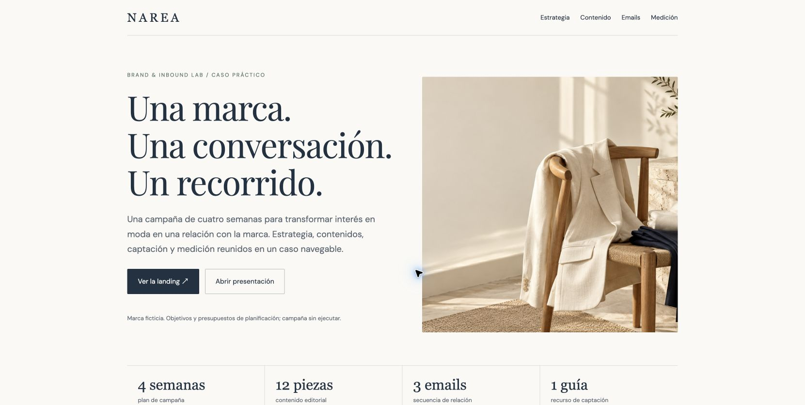

# NAREA — Brand & Inbound Lab

**Marketing digital · Estrategia inbound · Contenidos · Email marketing**

Un caso práctico para conectar el posicionamiento de una marca de moda con un recorrido de captación y relación con el cliente.

### [Explorar el proyecto ↗](https://paulacordobesfraga.github.io/narea.html)

## El reto
¿Cómo despertar interés por una marca nueva y aportar valor antes de pedir una compra? NAREA propone una guía de armario cápsula como punto de entrada, seguida de contenidos útiles y una invitación a la lista de lanzamiento.

## El proceso
1. **Definir la propuesta:** posicionamiento, audiencia hipotética y recorrido del cliente.
2. **Conectar los contenidos:** cuatro semanas, doce piezas, artículo SEO, carrusel y storyboard de Reel.
3. **Diseñar la captación:** landing funcional, guía y tres emails HTML.
4. **Planificar la medición:** indicadores, enlaces UTM, escenario de objetivos y propuesta exploratoria A/B.

## Entregables
| Recurso | Acceso |
|---|---|
| Caso navegable | [Abrir](https://paulacordobesfraga.github.io/narea.html) |
| Landing de campaña | [Probar](https://paulacordobesfraga.github.io/narea-landing.html) |
| Presentación de 12 páginas | [PDF](narea-NAREA-Brand-Inbound-Lab.pdf) |
| Calendario editorial | [CSV](narea-calendario-editorial.csv) |
| Plan de medición | [CSV](narea-medicion.csv) |
| Enlaces de campaña | [CSV](narea-enlaces-utm.csv) |

## Formación relacionada
Aplicación de conceptos de metodología inbound de HubSpot Academy y de branding y experiencia de cliente. El proyecto demuestra planificación y diseño; no implica integración operativa con HubSpot ni Google Analytics.

## Alcance
Marca ficticia y campaña propuesta, sin ejecutar. Las cifras son objetivos y escenarios de planificación, no resultados observados. Los formularios funcionan en el navegador, sin almacenar datos ni generar suscripciones. No hay envíos, contactos reales ni gasto publicitario. El Reel se presenta como storyboard.

## Abrir los archivos
Abre `narea.html` o sirve la carpeta con un servidor estático. No requiere backend ni claves. Antes de una campaña real habría que validar la audiencia y el producto, conectar los proveedores, revisar consentimientos y probar los eventos.

## Referencias
- [Metodología inbound — HubSpot](https://www.hubspot.com/inbound-marketing)
- [Buyer journey — HubSpot Academy](https://academy.hubspot.com/lessons/buyers-journey)
- [Enlaces UTM — Google Analytics](https://support.google.com/analytics/answer/10917952)
